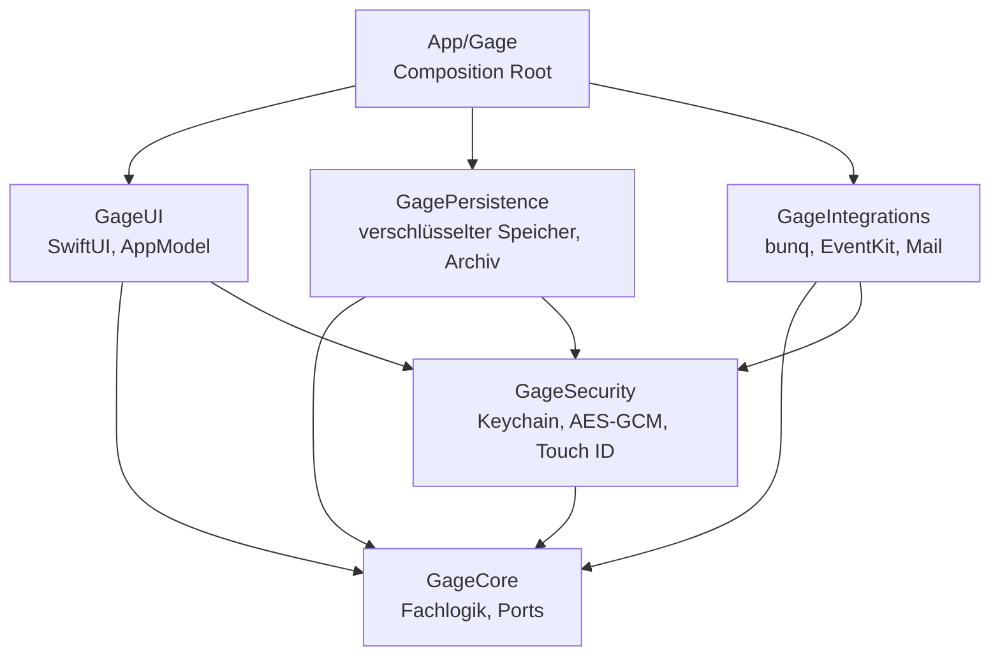
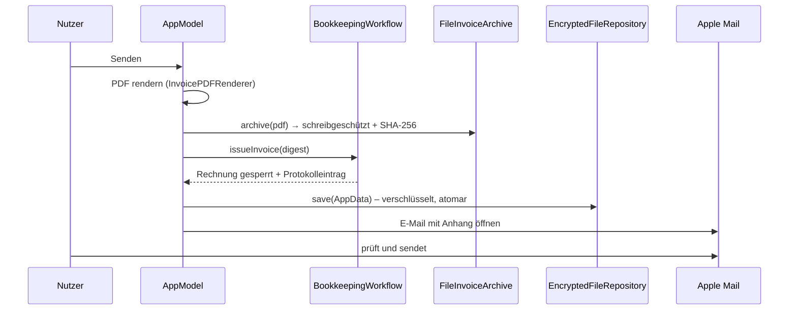

# Architektur

Gage folgt einer **Clean Architecture** mit klar getrennten Modulen in einem Swift Package (`Packages/GageKit`). Abhängigkeiten zeigen immer nach innen, zur Fachlogik.

## Module

| Modul | Verantwortung | Darf importieren |
| --- | --- | --- |
| `GageCore` | Entitäten (`Invoice`, `Customer`, `BankTransaction`), Wertobjekte (`Money`, `LocalDate`, `IBAN`), Regeln (`InvoiceValidator`, `PaymentMatcher`, `GigInvoicePlanner`, `ProfitReportCalculator`, `SmallBusinessMonitor`), Anwendungsfälle (`BookkeepingWorkflow`) und Ports (Protokolle) | nur Foundation |
| `GageSecurity` | `SecretStore` (Keychain), `DataEncryptor` (AES-256-GCM), `SHA256Digest`, `LocalAuthenticator`, `AppLockPolicy` | Core, Apple-Frameworks |
| `GagePersistence` | `EncryptedFileRepository` (Port `AppDataRepository`), `FileInvoiceArchive` (Port `InvoiceArchive`) | Core, Security |
| `GageIntegrations` | `BunqClient`/`BunqConnection` (Port `BankConnecting`), `EventKitGigSource` (Port `GigSource`), `SharingServiceMailComposer` (Port `MailComposing`) | Core, Security |
| `GageUI` | Ansichten, `AppModel`, `AppLockController`, PDF-Layout | alle Module außer App |
| `App/Gage` | Startpunkt, verdrahtet die echten Implementierungen (`CompositionRoot`) | alle |

## Grundsätze

- **Fachlogik ohne Seiteneffekte.** `BookkeepingWorkflow` arbeitet nur mit `inout AppData`. Laden, Speichern, Netzwerk und UI liegen außerhalb. So lässt sich jede Regel isoliert testen.
- **Ports und Adapter.** `GageCore` definiert Protokolle, die äußeren Module implementieren sie. Tests verwenden Fakes (`InMemorySecretStore`, `FakeBunqServer`).
- **Unveränderliche Rechnungen.** `Invoice` erlaubt Änderungen nur im Status `draft`. Nach dem Versand ändert sich nur noch der Zahlungsstatus.
- **Typen statt Konventionen.** `Money` (ganze Cent), `LocalDate` (Kalendertag ohne Zeitzone), `IBAN` und `EmailAddress` validieren sich selbst. Ungültige Werte können gar nicht erst entstehen.
- **Ein Datenstand.** Alle Daten liegen als ein verschlüsselter Snapshot vor (`AppData`), siehe [ADR 0002](adr/0002-verschluesselter-snapshot-speicher.md).
- **Keine Abhängigkeiten von Dritten.** Nur Apple-Frameworks, siehe [ADR 0003](adr/0003-keine-drittanbieter-abhaengigkeiten.md).

## Datenfluss: Rechnung senden

## Nebenläufigkeit

- `AppModel`, `AppLockController` und alle Views laufen auf dem `@MainActor`.
- Speicher, Archiv, bunq-Client und Kalender sind `actor`s.
- Strikte Concurrency-Prüfung ist im Package und im App-Target aktiv. Der Umstieg auf den Swift-6-Sprachmodus ist in [ADR 0005](adr/0005-swift-6-sprachmodus.md) beschrieben.
